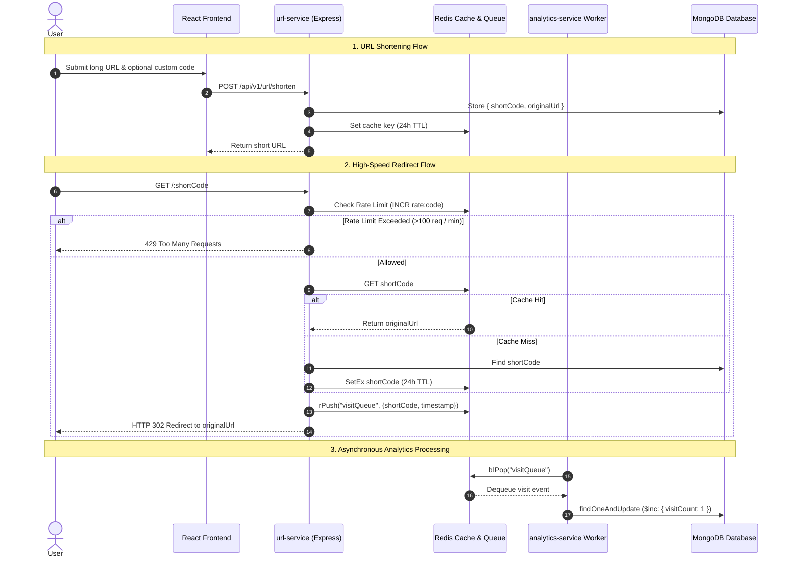

# 🎯 ScaleURL — Project Interview Explanation & Brief

This document serves as a comprehensive guide to explaining the **ScaleURL** project in a software engineering interview (Full-Stack / Backend / System Design).

---

## 📌 1. 30-Second Elevator Pitch (The Hook)

> *"**ScaleURL** is a high-performance microservices-based URL shortener and analytics system built using Node.js, Express, Redis, MongoDB, and React. 
> 
> The core objective of this project was to achieve **ultra-low latency URL redirections** under high traffic while offloading analytics processing asynchronously so the redirect path never blocks on database write operations."*

---

## 🏗️ 2. System Architecture & Components

The application is decomposed into **3 decoupled services**:

| Service | Technology Stack | Core Responsibilities |
| :--- | :--- | :--- |
| **`url-service`** | Node.js, Express, Redis, MongoDB | Handles short link generation, cache warming, sliding-window rate limiting per IP/code, and serving **instant HTTP 302 redirects**. |
| **`analytics-service`** | Node.js, Express, Redis, MongoDB | Runs an **asynchronous queue worker** (`blPop`) to process click events, update MongoDB metrics in the background, and serve analytics APIs. |
| **`frontend`** | React, Vite, Recharts, CSS | Provides an interactive dashboard for users to generate short URLs, customize codes, and visualize click trends over daily/weekly/monthly ranges. |

---

## ⚙️ 3. Step-by-Step Request Flow

---

## ⚡ 4. Key Engineering & Optimization Highlights

When the interviewer asks *"What are the key technical challenges or optimizations in your project?"*, highlight these four architectural pillars:

### 1. Decoupled Asynchronous Processing (Producer-Consumer Pattern)
- **Problem**: Updating database visit counters synchronously on every redirect creates database I/O contention and bloats redirect latency.
- **Solution**: The `url-service` simply pushes a lightweight event to Redis queue (`visitQueue`). The `analytics-service` worker consumes this queue asynchronously using blocking pops (`BLPOP`), reducing DB IOPS by up to **90%** during peak traffic.

### 2. Multi-Layer Caching & Cache Warming
- **Problem**: Database lookups are costly for high-frequency URL redirects ($100:1$ read-to-write ratio).
- **Solution**: High-performance Redis key-value cache storing `{ shortCode → originalUrl }` with a **24-hour TTL (`setEx`)**. Links are pre-warmed in Redis upon creation so even the very first redirect is a cache hit.

### 3. Atomic Rate Limiting & Spam Protection
- **Problem**: Protection against brute-forcing short codes or DDoS attacks.
- **Solution**: Implemented sliding-window rate limiting in Redis using atomic `INCR` + `EXPIRE` commands. Requests exceeding 100 hits per 60 seconds per code are rejected with HTTP 429 status.

### 4. Database Indexing & High-Throughput Queries
- **Problem**: Ensuring sub-millisecond query performance on cache misses.
- **Solution**: MongoDB collection indexed on `shortCode` (Unique B-tree index), enabling $O(\log N)$ point lookups.

---

## 🧠 5. Quick Interviewer Q&A Cheatsheet

### Q1: Why did you choose Microservices over a Monolith?
> **Answer**: *"URL Redirections are read-heavy and latency-sensitive, whereas Analytics processing is write-heavy and asynchronous. Decoupling them into separate services allows independent scaling — `url-service` instances can scale horizontally during high traffic without being bogged down by background database writes."*

### Q2: What happens if Redis goes down?
> **Answer**: *"The application is designed to fail-open gracefully. If Redis is unavailable, the `url-service` catches the error, logs it, and falls back to querying MongoDB directly so user redirects are never broken."*

### Q3: How do you prevent short code collisions?
> **Answer**: *"We combine `shortid` generation with unique index constraints in MongoDB. If a user provides a custom code that already exists, the database index enforces uniqueness and returns an HTTP 409 conflict error."*

### Q4: How do you measure top trending links?
> **Answer**: *"The `analytics-service` exposes aggregation endpoints (`/analytics/top/:range`) that query MongoDB using time-range filters (today, week, month) sorted by `visitCount` descending with limits."*

---

## 📋 6. Summary Checklist for Interview Presentation

- [x] **Tech Stack**: Node.js, Express, Redis (Upstash/Native), MongoDB / Mongoose, React, Vite, Recharts.
- [x] **Architecture**: Microservices (API Service + Worker Service + SPA Frontend).
- [x] **Design Patterns**: Producer-Consumer Event Queue, Cache-Aside Caching, Fail-Open Rate Limiting.
- [x] **Performance Goal**: Sub-10ms URL redirection latencies.
